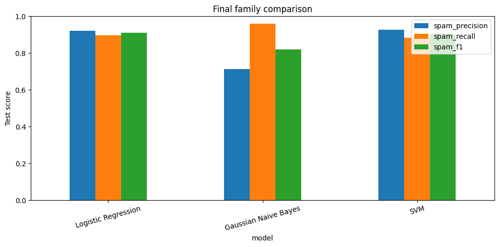
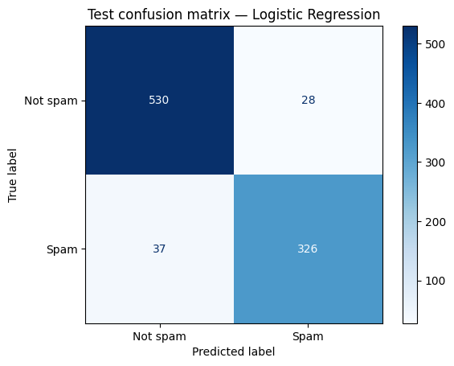

# Spam Filter Model Comparison

**Three classifiers. One dataset. A closer look at the cost of getting spam wrong.**

This project compares Logistic Regression, Gaussian Naive Bayes, and an RBF Support Vector Machine on UCI Spambase. Each model family is tuned on validation data, refit on the full training pool, and evaluated on a held-out test set.

[Explore the notebook](SpamClassifiers.ipynb) · [Chart export script](scripts/export_notebook_charts.py)

## At a glance

| Dataset | Features | Development / validation / test | Random seed |
| :--- | :--- | :--- | :--- |
| UCI Spambase, ID 94 | 57 numeric features | 3,128 / 552 / 921 emails | 42 |

The dataset contains **4,601 emails**. The target label is `1` for spam and `0` for non-spam. This notebook uses numeric email features, rather than a raw-text preprocessing pipeline.

## Results

**Logistic Regression achieved the highest observed test spam F1: 0.9093.** SVM followed closely, while Gaussian Naive Bayes caught the largest share of spam but had lower precision.

| Model | Selected parameter | Accuracy | Spam precision | Spam recall | Spam F1 |
| :--- | :--- | ---: | ---: | ---: | ---: |
| **Logistic Regression** | `C=1.0` | **0.9294** | 0.9209 | 0.8981 | **0.9093** |
| RBF SVM | `C=1.0`, `gamma='scale'` | 0.9273 | **0.9277** | 0.8843 | 0.9055 |
| Gaussian Naive Bayes | `var_smoothing=1e-9` | 0.8328 | 0.7146 | **0.9587** | 0.8188 |



These values and charts come from the notebook's saved execution outputs. They describe one fixed split; the small F1 difference between Logistic Regression and SVM does not establish a statistically significant advantage.

## Where the best observed model makes mistakes



| Actual class | Predicted non-spam | Predicted spam |
| :--- | ---: | ---: |
| Non-spam | 530 | 28 |
| Spam | 37 | 326 |

Logistic Regression incorrectly sent **28 legitimate emails to spam** and let **37 spam emails through**. Precision measures how many flagged emails are actually spam; recall measures how much spam is caught. F1 balances the two.

For a filter where losing legitimate mail is especially costly, false positives deserve close attention. SVM has the highest observed precision here, while Naive Bayes favors recall. Any threshold tuning should use validation data and a fresh final evaluation.

## How the experiment works

1. Fetch UCI Spambase using `ucimlrepo` and convert features to numeric values.
2. Hold out 20% for testing, then reserve 15% of the remaining training pool for validation. Both splits are stratified with `random_state=42`.
3. Fit a pipeline of median imputation, standard scaling, and classification on development data. Preprocessing is learned within each pipeline.
4. Try three parameter values per family and select by validation spam F1, with spam precision as the tie-breaker.
5. Refit each selected pipeline on all 3,680 training-pool examples and evaluate it on the 921 test examples.

| Model family | Validation search | Selected validation spam F1 |
| :--- | :--- | ---: |
| Logistic Regression | `C`: `0.1`, `1`, `10` | 0.9014 |
| Gaussian Naive Bayes | `var_smoothing`: `1e-9`, `1e-7`, `1e-5` | 0.7977 |
| RBF SVM | `C`: `0.1`, `1`, `10`; `gamma='scale'` | 0.9362 |

The final test comparison is descriptive: it is not an additional hyperparameter search or an ensemble.

## Run locally

Use Python 3 with a Jupyter environment:

```bash
python3 -m venv .venv
source .venv/bin/activate
python -m pip install jupyter ipykernel numpy pandas matplotlib scikit-learn ucimlrepo
jupyter notebook SpamClassifiers.ipynb
```

Select the virtual environment's Python kernel and run the notebook from top to bottom. Internet access is needed to fetch the dataset. Package versions are not pinned, so results may vary across environments.

**Notebook caveat:** the final assignment-check cell references `STUDENT_NAME` and `LAB_DATE`, which are not defined in the committed notebook. Define those variables in an earlier cell, or skip the final assignment-check cell. The model evaluation and charts appear before it.

## Refresh the README charts

After rerunning the notebook, **save it with its outputs**, then run:

```bash
python3 scripts/export_notebook_charts.py
```

The script extracts the two saved PNG outputs directly from the final visualization cell into `assets/charts/`. It uses only the Python standard library and does not retrain models. If results change, update the README's result tables and discussion to match the new outputs.

## Repository guide

- [`SpamClassifiers.ipynb`](SpamClassifiers.ipynb): data preparation, validation searches, test evaluation, and visualizations.
- [`assets/charts/`](assets/charts/): notebook charts embedded in this README.
- [`scripts/export_notebook_charts.py`](scripts/export_notebook_charts.py): repeatable export of the notebook's saved charts.
